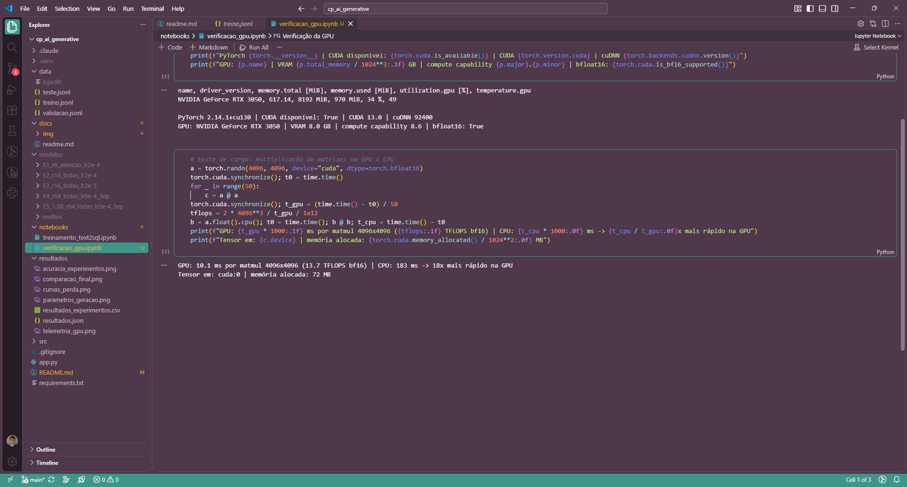
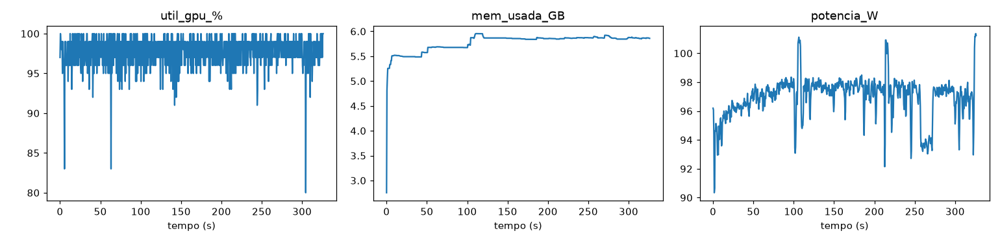
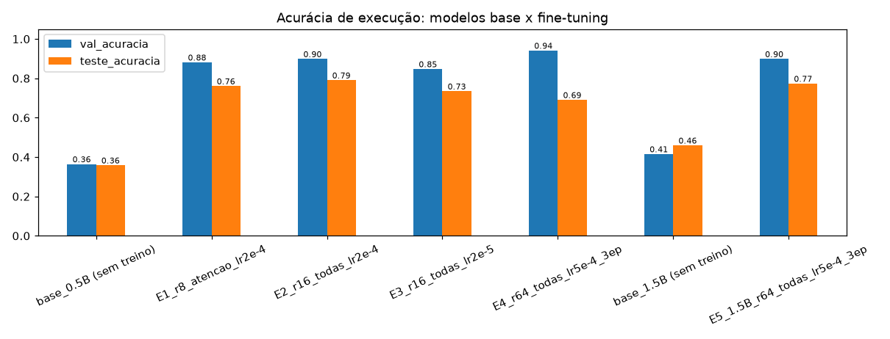
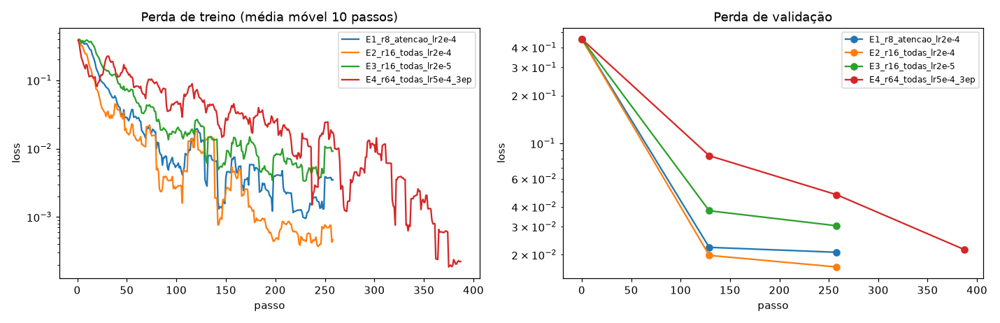
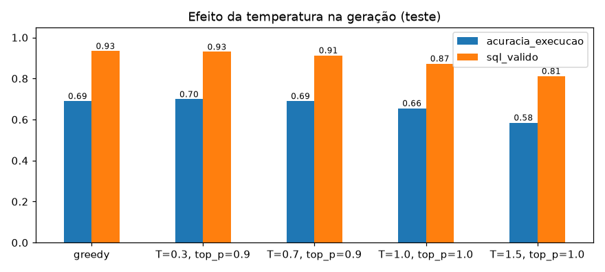
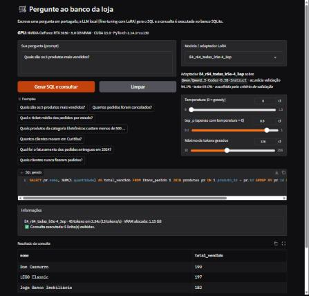

# Text-to-SQL em português com LLM local (fine-tuning LoRA na GPU)

Checkpoint de **IA Generativa — FIAP**. Treinamos uma LLM local para resolver um problema específico:
**converter perguntas de negócio em português em consultas SQL** sobre o banco de dados de uma loja virtual.
O usuário digita a pergunta em um frontend web, a LLM gera o SQL e a consulta é executada no banco.

> Enunciado original: [`docs/readme.md`](docs/readme.md)

| Requisito do enunciado | Onde está |
|---|---|
| Selecionar/escolher LLM | [Escolha do modelo](#escolha-do-modelo) |
| Escolher um problema específico | [Problema](#problema) |
| Testar diferentes parâmetros | [Experimentos](#experimentos-e-resultados) — 4 configurações LoRA, 2 tamanhos de modelo, 5 configurações de geração |
| Verificar/avaliar o modelo (respostas) | [Avaliação](#avaliação) — acurácia por execução do SQL, análise de erros, comparação qualitativa |
| Fazer todos os testes utilizando GPU | Todo treino/inferência roda em CUDA ([GPU](#gpu)) |
| Frontend para o usuário inserir o prompt | [`app.py`](app.py) (Gradio) |
| Print da GPU funcionando no VSCode | [GPU](#gpu) (`docs/img/gpu_vscode.png`) |
| Documentação e código no GitHub | este repositório |

## Estrutura

```
├── notebooks/treinamento_text2sql.ipynb   # notebook com TODO o treinamento e avaliação (executado, com saídas)
├── notebooks/verificacao_gpu.ipynb        # verificação rápida da GPU (nvidia-smi, PyTorch/CUDA, teste de carga)
├── app.py                                 # frontend Gradio (prompt -> SQL -> resultado)
├── src/
│   ├── banco.py       # cria o banco SQLite sintético da loja (data/loja.db)
│   ├── dataset.py     # gera o dataset pergunta -> SQL (treino/validação/teste)
│   └── avaliacao.py   # prompt, geração em lote e métricas (execução do SQL)
├── data/              # dataset gerado (treino.jsonl, validacao.jsonl, teste.jsonl)
├── resultados/        # gráficos, CSV e JSON com as métricas dos experimentos
├── modelos/           # adaptadores LoRA gerados (ignorado pelo git)
└── docs/              # enunciado e prints
```

## Problema

Analistas de uma loja virtual querem responder perguntas como *"Quais são os 5 produtos mais vendidos?"* ou
*"Qual o ticket médio por estado?"* sem saber SQL. A tarefa da LLM é gerar a consulta SQL (dialeto SQLite) correta
a partir da pergunta e do esquema do banco.

Escolhemos esse problema porque **a resposta pode ser verificada objetivamente**: o SQL gerado é executado e o resultado
é comparado com o da consulta de referência. Isso permite comparar modelos e hiperparâmetros com números, e não só "no olho".

### Banco de dados
SQLite sintético e determinístico ([`src/banco.py`](src/banco.py)) com 4 tabelas: `clientes` (200), `produtos` (54),
`pedidos` (1.500) e `itens_pedido` (~3.700).

### Dataset
Gerado por [`src/dataset.py`](src/dataset.py) a partir de **41 templates** de consulta (filtros, agregações, `GROUP BY`,
`JOIN` de até 3 tabelas, subconsultas `NOT IN`, funções de data, `ORDER BY/LIMIT`), cada um com **5 paráfrases** em português.

Para que a avaliação meça generalização (e não memorização), o teste é dividido em:

| Tipo de exemplo de teste | O que mede |
|---|---|
| `parafrase_inedita` | a 5ª forma de perguntar de cada template **nunca** aparece no treino nem na validação |
| `valores_novos` | pergunta conhecida com valores (cidade, ano, nome...) que não aparecem no treino daquele template |
| `tipo_inedito` | 3 templates inteiros **fora do treino** (consultas que o modelo nunca viu) |

O treino usa só as paráfrases 1–3; a **validação** usa apenas a 4ª paráfrase (também inédita) e serve para escolher a
configuração; o **teste** (5ª paráfrase + valores novos + tipos inéditos) só serve para reportar o resultado final.
Tamanhos: **1.026 treino / 118 validação / 229 teste**.

## Escolha do modelo

**[`Qwen/Qwen2.5-Coder-0.5B-Instruct`](https://huggingface.co/Qwen/Qwen2.5-Coder-0.5B-Instruct)** (Apache 2.0):
- versão *instruct* especializada em código (inclui SQL), com bom entendimento de português;
- 0,5 B de parâmetros: cabe com folga nos 8 GB da RTX 3050 e treina em poucos minutos, permitindo **vários experimentos**;
- comparamos também com **`Qwen2.5-Coder-1.5B-Instruct`** para medir o efeito do tamanho do modelo.

**Técnica:** fine-tuning supervisionado com **LoRA** (biblioteca PEFT), pesos em `bfloat16`, laço de treino em PyTorch
(AdamW, warmup + decaimento linear, gradient clipping). A perda é calculada só nos tokens da resposta (SQL).

## GPU

| | |
|---|---|
| GPU | NVIDIA GeForce RTX 3050 — 8 GB VRAM, compute capability 8.6 (Ampere), suporte a `bfloat16` |
| Driver / CUDA | driver 617.14 (CUDA 13.x) · PyTorch 2.14.1 + CUDA 13.0 · cuDNN 9.24 |
| Utilização média da GPU nos treinos | 97–99 % (medido via NVML durante o treino) |

Print da GPU instalada e funcionando dentro do VSCode ([`notebooks/verificacao_gpu.ipynb`](notebooks/verificacao_gpu.ipynb)):
a RTX 3050 é reconhecida pelo PyTorch com CUDA 13.0, e uma multiplicação de matrizes 4096×4096 em `bfloat16` roda
18× mais rápido na GPU do que na CPU (13,7 TFLOPS).



O notebook começa imprimindo `nvidia-smi` e as propriedades da GPU vistas pelo PyTorch, e registra telemetria
(utilização, memória, temperatura, potência) durante cada treino:



**Otimização necessária para caber na GPU:** o vocabulário do Qwen tem ~151 mil tokens; a matriz de *logits* de um lote de
8 exemplos × ~330 posições ocupava vários GB e estourava os 8 GB (o Windows passava a usar a RAM do sistema e o passo de
treino ficava ~3–6× mais lento). Como a perda só usa as posições do SQL, aplicamos o `lm_head` **apenas nessas posições**:

| Configuração (0,5 B, batch 8) | antes | depois |
|---|---|---|
| LoRA r=8 (atenção) | 1,60 s/passo · 14,2 GB reservados | 0,53 s/passo · 4,9 GB |
| LoRA r=64 (todas as camadas) | não cabia na VRAM | 0,72 s/passo · 6,4 GB |

O modelo de 1,5 B também usa *gradient checkpointing* (pico de 4,6 GB).

## Experimentos e resultados

Métrica principal: **acurácia de execução** — o SQL gerado é executado e o resultado precisa ser idêntico ao da consulta de
referência. Também medimos *match* exato do texto e % de SQL válido. Geração *greedy*, salvo indicação.

### Hiperparâmetros testados

| Experimento | Modelo | LoRA `r`/`alpha` | Camadas com LoRA | LR | Épocas | Parâm. treináveis |
|---|---|---|---|---|---|---|
| E1 | 0,5 B | 8 / 16 | atenção (q,k,v,o) | 2e-4 | 2 | 1,1 M (0,2 %) |
| E2 | 0,5 B | 16 / 32 | todas as lineares | 2e-4 | 2 | 8,8 M (1,7 %) |
| E3 | 0,5 B | 16 / 32 | todas as lineares | 2e-5 | 2 | 8,8 M (1,7 %) |
| E4 | 0,5 B | 64 / 128 | todas as lineares | 5e-4 | 3 | 35,2 M (6,6 %) |
| E5 | 1,5 B | 64 / 128 | todas as lineares | 5e-4 | 3 | 73,9 M (4,6 %) |

Fixos: batch efetivo 8, dropout 0,05, AdamW, warmup 5 % + decaimento linear, semente 42. E5 repete no modelo maior a
configuração vencedora na validação (E4).

### Resultados

| Modelo | Acurácia validação | **Acurácia teste** | Match exato (teste) | SQL válido (teste) | Tempo de treino | Pico VRAM |
|---|---|---|---|---|---|---|
| Qwen 0,5 B sem treino | 36,4 % | 35,8 % | 21,8 % | 65,1 % | — | — |
| Qwen 1,5 B sem treino | 41,5 % | 45,9 % | 28,4 % | 80,8 % | — | — |
| E1 (r8, atenção) | 88,1 % | 76,0 % | 75,1 % | 92,1 % | 2,7 min | 3,0 GB |
| **E2 (r16, todas, LR 2e-4)** | 89,8 % | **79,0 %** | 78,6 % | 96,9 % | 3,7 min | 3,8 GB |
| E3 (r16, todas, LR 2e-5) | 84,7 % | 73,4 % | 71,6 % | 90,8 % | 3,7 min | 3,8 GB |
| E4 (r64, LR 5e-4, 3 ép.) | **94,1 %** | 69,0 % | 68,1 % | 93,4 % | 5,4 min | 4,3 GB |
| E5 (1,5 B, config. E4) | 89,8 % | 77,3 % | 77,3 % | 97,8 % | 18,2 min | 4,6 GB |




Acurácia no teste por tipo de exemplo:

| Tipo de teste | 0,5 B sem treino | 1,5 B sem treino | E4 (escolhido) |
|---|---|---|---|
| paráfrase inédita | 31,7 % | 41,0 % | 66,9 % |
| valores novos | 37,8 % | 53,3 % | 97,8 % |
| tipo de consulta inédito | 46,7 % | 53,3 % | 46,7 % |

### Parâmetros de geração (modelo E4, conjunto de teste)

| Decodificação | Acurácia | SQL válido |
|---|---|---|
| greedy | 69,0 % | 93,4 % |
| T=0,3, top_p=0,9 | 69,9 % | 93,0 % |
| T=0,7, top_p=0,9 | 69,0 % | 91,3 % |
| T=1,0, top_p=1,0 | 65,5 % | 87,3 % |
| T=1,5, top_p=1,0 | 58,5 % | 81,2 % |



## Avaliação

**O que funcionou**
- O fine-tuning com LoRA **mais que dobrou** a acurácia: de 36 % (0,5 B sem treino) para até 79 % no teste, treinando
  só 1,7 % dos parâmetros em menos de 4 minutos. O modelo de 0,5 B treinado supera com folga o de 1,5 B sem treino (46 %).
- O modelo treinado aprende as convenções do banco que o modelo base erra: usar `estado = 'SP'` (e não `cidade = 'SP'`),
  `strftime` para datas, `valor_total` em vez de recalcular preços, aliases e formato das respostas. O % de SQL válido sobe
  de 65 % para 93–98 %.
- Para valores novos em perguntas conhecidas a acurácia é quase perfeita (~98 %).

**Efeito dos hiperparâmetros**
- **LoRA em todas as camadas lineares (E2) > só na atenção (E1)**, com o mesmo LR: +3 p.p. no teste e menor perda de validação.
- **Learning rate 10× menor (E3)** aprende mais devagar: perda de validação maior e −6 p.p. no teste (subtreinado em 2 épocas).
- **Alta capacidade + LR alto + 3 épocas (E4)** levou a perda de treino a ~2e-4 e teve a **maior acurácia de validação**,
  mas a **menor no teste** entre os treinados: sinal de **sobreajuste** às formas de perguntar vistas no treino.
- **Modelo maior (E5, 1,5 B)** com a mesma configuração do E4 generalizou melhor que o E4 (77 % vs 69 %), mas custou 3,4× mais
  tempo de treino e é mais lento na inferência.
- **Temperatura:** valores baixos (≤ 0,7) ficam praticamente iguais ao *greedy*; acima de 1,0 a qualidade cai e aparecem
  SQLs inválidos. Para uma tarefa determinística como gerar SQL, *greedy* (ou temperatura baixa) é o adequado.

**Seleção do modelo e limitações (análise honesta)**
- O protocolo escolhe o modelo pela acurácia na **validação**, e por ela o vencedor foi o **E4**. No teste, porém, o **E2**
  foi melhor (79 % vs 69 %). Não trocamos o modelo olhando o teste (isso seria vazamento de dados de teste); o frontend
  permite escolher qualquer um dos adaptadores para comparação. A discrepância vem de a validação ter **uma única paráfrase
  por template**: o E4 memoriza mais e acerta a 4ª paráfrase, mas erra a 5ª. Melhoria futura: validação com várias
  paráfrases ou validação cruzada por paráfrase.
- **Tipos de consulta inéditos** continuam difíceis (~47 %, igual ao modelo base): o fine-tuning ensina as convenções, mas
  não cria capacidade composicional para estruturas nunca vistas. Mais templates e dados mais variados ajudariam.
- Erros típicos (modelo E4 no teste): interpretar "mais em conta" como `ORDER BY preco DESC`; tratar "compras que passaram
  de 100 reais" como produtos (`produtos.preco`) em vez de pedidos; responder "quantos produtos de Livros a loja já vendeu"
  com `COUNT(*)` do catálogo em vez de `SUM(quantidade)`; e filtrar por `cidade` quando a pergunta cita um estado por extenso
  ("moram em Minas Gerais") ou combina estado com status de pedido (template inédito).
- Na primeira versão do experimento a validação usava as mesmas paráfrases do treino: todos os modelos chegavam a ~100 % e o
  critério escolhia o mais sobreajustado. Corrigimos para a validação usar uma paráfrase reservada.


## Como executar

Pré-requisitos: GPU NVIDIA com driver recente, Python 3.12.

```bash
python -m venv .venv
.venv\Scripts\activate
pip install torch --index-url https://download.pytorch.org/whl/cu130
pip install -r requirements.txt
```

1. **Treino:** abra `notebooks/treinamento_text2sql.ipynb` no VSCode, selecione o kernel da `.venv` e execute todas as células
   (≈ 50 min numa RTX 3050, sendo ~18 min só do modelo de 1,5 B). O melhor adaptador é salvo em `modelos/melhor/`.
2. **Frontend:**

```bash
python app.py
```

   Acesse http://127.0.0.1:7860, digite a pergunta (ou clique num exemplo), ajuste temperatura/top_p/máx. de tokens e veja o
   SQL gerado e o resultado da consulta. No seletor *Modelo / adaptador LoRA* dá para usar qualquer experimento (E1–E5) ou o
   modelo base sem fine-tuning, para comparar as respostas. O banco é aberto em modo somente leitura e só consultas `SELECT`
   são executadas.



## Grupo

| Nome | RM |
|---|---|
| Julio Cesar Zampieri | 98772 |
| Bruno Venturi Lopes Vieira | 99431 |
| Leonardo de Oliveira Ruiz | 98901 |
| Ricardo Matos | 95906 |
| João Gabriel Dias Nascimento | 99092 |
